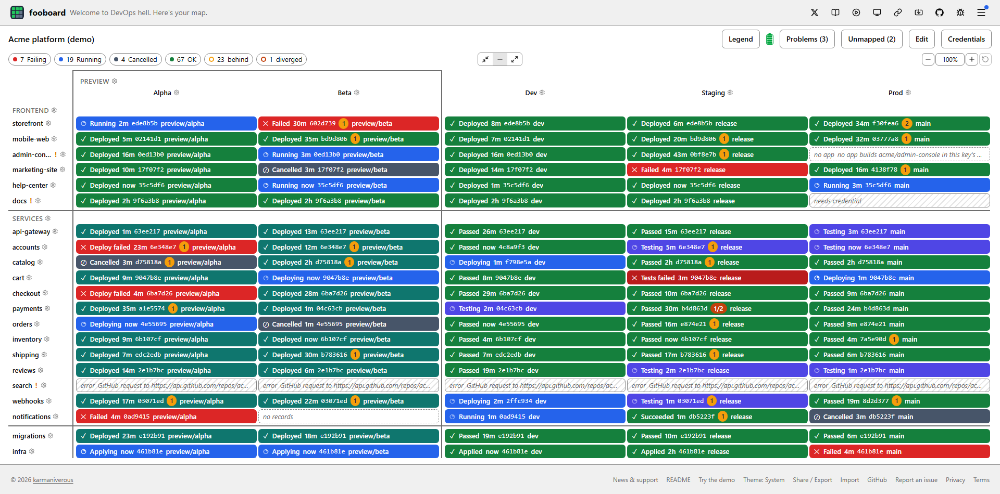
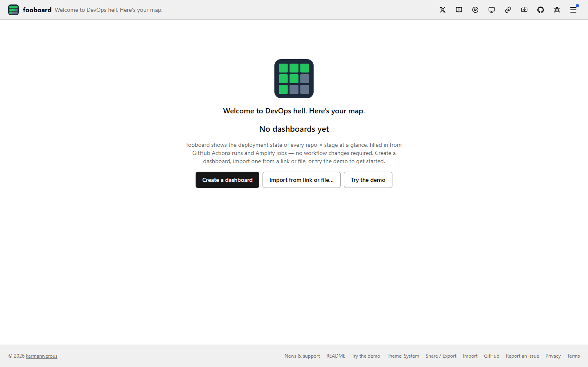
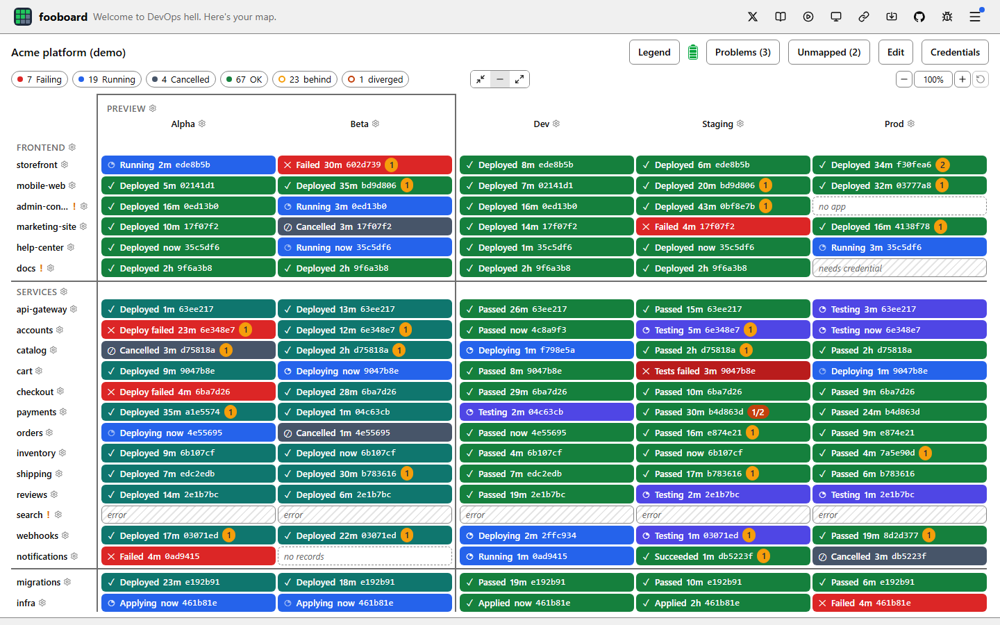
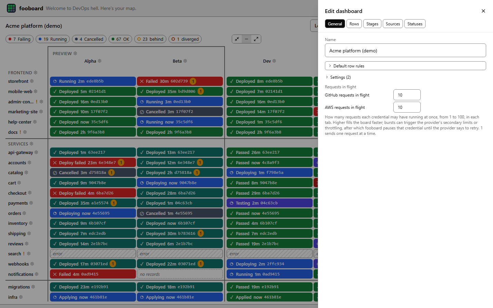
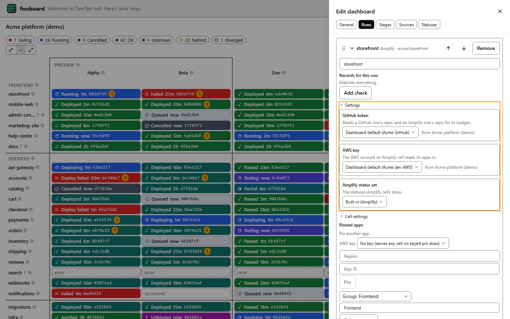
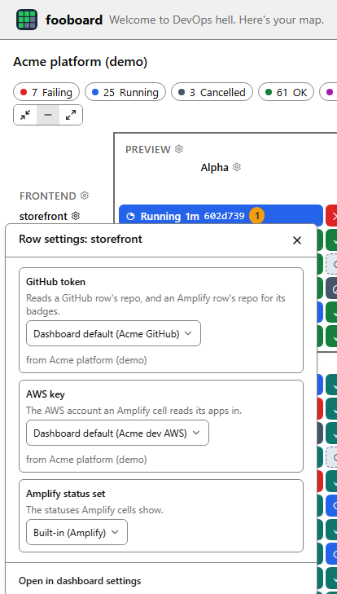
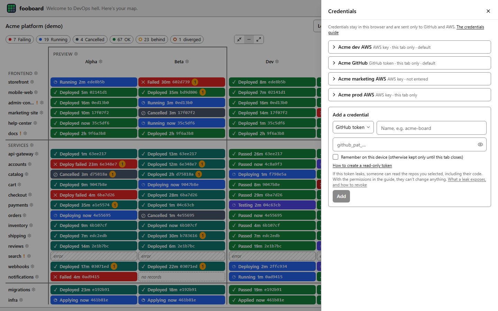

<div align="center">


# fooboard

**Welcome to DevOps hell. Here's your map.**

[](https://fooboard.dev/demo)
[](https://github.com/karmaniverous/fooboard/actions/workflows/ci.yml)
[](https://github.com/karmaniverous/fooboard/tree/main/LICENSE)
[](https://github.com/karmaniverous/fooboard/tree/main/CHANGELOG.md)
[](https://x.com/fooboarding)

</div>

<picture>
  <source media="(prefers-color-scheme: dark)" srcset="docs/screenshots/demo-dark.png" />
  
</picture>

fooboard shows the deployment state of every repo × stage at a glance, live at [fooboard.dev](https://fooboard.dev). Paste a GitHub token, pick your repos and a branch preset, and the board fills itself in from your GitHub Actions runs (and, if you use them, AWS Amplify builds). No workflow changes, no account, no server: it is a free, open-source, static web app, and nothing leaves your browser except the calls it makes directly to GitHub and AWS.

**Try it now:** open [fooboard.dev](https://fooboard.dev), or try the demo first at [fooboard.dev/demo](https://fooboard.dev/demo) (no account or token needed). Running fooboard locally is for contributors; see [CONTRIBUTING](./CONTRIBUTING.md).

**Set up with an AI assistant:** Paste fooboard.dev/ai into your assistant. See [Set up with an AI assistant](#set-up-with-an-ai-assistant).

## Contents

- [Try the demo](#try-the-demo)
  - [Demo account](#demo-account)
- [Getting started](#getting-started)
- [Set up with an AI assistant](#set-up-with-an-ai-assistant)
- [Reading the board](#reading-the-board)
- [Editing a dashboard](#editing-a-dashboard)
- [Settings](#settings)
- [Rules](#rules)
- [Unmapped runs](#unmapped-runs)
- [Credentials](#credentials)
- [Sharing, export and import](#sharing-export-and-import)
- [Header, menu and footer](#header-menu-and-footer)
  - [Release notes](#release-notes)
  - [When something goes wrong](#when-something-goes-wrong)
- [Your data](#your-data)
- [Releasing and deployment](#releasing-and-deployment)
  - [Hosting](#hosting)
- [Contributing](#contributing)
- [License](#license)

## Try the demo

_Try the demo_ (on the home page, or the play button in the header) opens a board for a fictional company, `acme`, with no account or token. It is fooboard itself, the same board, panels and editors, reading a GitHub and an AWS that are simulated in your browser: nothing leaves it.

The board is shaped like a real pipeline: a _Preview_ group (Alpha, Beta), then _Dev_, _Staging_ and _Prod_; a _Frontend_ group of Amplify apps, a _Services_ group of GitHub repos and an _infra_ row on its own. Commits land on dev every few minutes and are promoted to the previews, staging and prod, so new runs keep arriving and **behind** badges come and go.

Within the first ten minutes it shows every status, badge, empty state and unmapped run described below; two minutes in, a new run starts on _accounts_ / _Prod_ whose jobs take a few seconds to load, so that cell shows the **refreshing** dot meanwhile. Every visit plays the same story from the moment you open it.

You can change anything: the gears' popups, _Edit dashboard_ (the dashboard editor) and _Credentials_ all work. What you change lasts until you reload or leave the demo; nothing is saved, except zoom and density, which are saved on your device as for any board.

### Demo account

The simulated account behind the demo holds more than the board shows, so the editors' pickers have something to pick:

- **GitHub** (the _Acme GitHub_ token): the board's repos plus `acme/design-system`, `acme/data-pipeline` and `acme/sandbox`, and branches such as `feature/new-checkout` and `hotfix/checkout-timeout`.
- **AWS**: two keys, _Acme dev AWS_ (the previews, dev and staging, in us-east-1 and us-west-2, plus a `sandbox` app the board doesn't show) and _Acme prod AWS_ (the _Prod_ column's own key). _Acme marketing AWS_ is listed but has no key entered, so the one cell that uses it, _docs_ / _Prod_, shows **Needs credential**.

Its tokens and keys are demo values the simulator alone accepts; they mean nothing to GitHub or AWS. Entering your own token in the demo reads nothing real: the demo never sends a request.

<picture>
  <source media="(prefers-color-scheme: dark)" srcset="docs/screenshots/home-dark.png" />
  
</picture>

## Getting started

The home page offers four ways in: _Create a dashboard_, _Import from link or file…_ (a board someone shared: choose its file, or paste its link or JSON; see [Sharing, export and import](#sharing-export-and-import)), _Set up with an AI assistant…_ (your assistant builds the board with you; see [Set up with an AI assistant](#set-up-with-an-ai-assistant)) and _Try the demo_.

_Create a dashboard_ walks you through four steps. Each step's heading takes the keyboard focus as it opens, so a screen reader announces it.

1. **Add a GitHub token.** Name the dashboard (it is _My dashboard_ if you don't) and paste a read-only token; _How to create a read-only token_ opens the guide ([GitHub token](#github-token)). The token is kept for this tab unless you tick _Remember on this device_. It becomes the dashboard's own GitHub token (its _GitHub token_ setting, [Settings](#settings)), which every row reads with unless you set another. Every dashboard starts from a GitHub token, so there's no skip.
2. **Pick your repos.** The repos the token can see are listed (search to narrow them); each one you tick becomes a row.
3. **Set up your stages.** fooboard reads the branches in those repos and suggests the branch preset that fits them best: _Environment branches_ (dev, staging, prod ← `main`), _Gitflow_ (dev ← `develop`, test ← `release/**`, prod ← `main`) or _Release train_ (dev, release ← `release/**`, prod ← `main`, with preview stages). The best fit is the preset whose stages match a branch in the most repos; with the release train, repos with preview branches count too.

   Each `preview/<name>` branch names a preview stage (`preview/bali` gives _bali_, sourced from dev), all ticked; `preview/release` names none, since _release_ is already a stage. Choose another preset, untick previews, or choose _Blank_ to add stages yourself; each stage shows how many of your repos have a branch it matches. _Back to repos_ returns to step 2.

4. **Your board.** The board opens and fills in as GitHub answers. A note above it says how many runs landed in no cell (_Unmapped runs (N)_ lists them, with a fix for each; [Unmapped runs](#unmapped-runs)) and how many rule problems are marked ! (_Problems (N)_), and names _Edit dashboard_ for changes, each button shown with its icon as on the board. _Done_ closes the note.

New dashboards use the built-in source rules and status sets. Add Amplify rows, rename or re-pattern stages and tweak rules afterwards with _Edit dashboard_ ([Editing a dashboard](#editing-a-dashboard)). A dashboard lives at `/d/<id>` in this browser.

## Set up with an AI assistant

Paste fooboard.dev/ai into your assistant. Any assistant that can read a web page will do (ChatGPT, Claude, Gemini and the like): fooboard has no assistant of its own and sends nothing to one.

1. Open _Set up with an AI assistant_ (in the header, the menu or the footer, or on the home page) and press _Copy prompt_, or copy the address alone with _Copy link_: [https://www.fooboard.dev/ai](https://www.fooboard.dev/ai).
2. Paste it into your assistant. It reads fooboard's instructions there, then asks you about your repos, Amplify apps, stages and the branches that feed them, groups, and your credentials by name only.
3. It gives you a link (`https://www.fooboard.dev/#j=…`). Open it and choose _Import_. If it can't build a link, it gives you the board's JSON instead: paste that into _Import_ (_Or a fooboard link, or its JSON_).
4. The board opens with _Credentials_ open on the first credential that has no secret on this device: enter each token and key there ([Credentials](#credentials)). Your keys never pass through the assistant, and the instructions tell it never to ask for them.

If fooboard refuses what the assistant built, the import lists each problem as a path into the share and a message (for example `dashboards[0].stages[1].id: …`); _Copy errors for your assistant_ copies them all, to paste back so it can correct the share. A share that imports but whose board lists configuration problems works the same way: the _Problems_ panel offers _Copy problems for your assistant_.

What you tell your assistant (repo, branch and app names) is between you and its provider ([PRIVACY.md](./PRIVACY.md)). The instructions are plain markdown at [/ai](https://www.fooboard.dev/ai), with the share's JSON Schema at [/ai.schema.json](https://www.fooboard.dev/ai.schema.json) and an [/llms.txt](https://www.fooboard.dev/llms.txt) for assistants that look for one.

## Reading the board

<picture>
  <source media="(prefers-color-scheme: dark)" srcset="docs/screenshots/board-dark.png" />
  
</picture>

Each **row** is a repo (or an Amplify app, or one deployable unit in a repo), and each **column** a stage (for the built-in presets, a branch or a pattern such as `release/*`). Each **cell** shows the newest record that its row's and its column's [rules](#rules) place there, as the first status in its **status set** whose rule the record matches. The built-in sets:

| Set                                                | Statuses (first match wins)                                                                                             |
| -------------------------------------------------- | ----------------------------------------------------------------------------------------------------------------------- |
| _GitHub deploy and test_ (default for GitHub rows) | Tests failed, Deploy failed, Cancelled, Testing, Deploying, Passed, Deployed, Partial (deployed, tests to come), Queued |
| _GitHub single job_                                | Failed, Cancelled, Running, Queued, Succeeded                                                                           |
| _Amplify_ (default for Amplify rows)               | Failed, Cancelled, Running, Queued, Deployed                                                                            |

Each status has a name, a colour, an icon (✓ success, ✕ failure, ◔ running, ◑ partial, ○ queued, ⊘ cancelled) and can be outlined, as Queued is. A status in progress pulses. Text on a cell is white or near-black, whichever reads better on its colour.

A record that matches no status shows **Unknown** (purple, ?), so a gap in the rules is visible; see [Rules](#rules).

A cell can carry a **badge**: _behind_ (amber, with a count; its name and tooltip say "1 commit behind" or "3 commits behind") when its branch is missing commits from the stage it is promoted from, or _diverged_ (with `behind/ahead`) when it also has commits the source lacks. A badge links to GitHub's compare page. Badges need git: they show on rows linked to a GitHub repo (a GitHub row's own repo; an Amplify row's repo) when the cell's record has a commit and a branch.

An **empty cell** says why: _no records_, _needs credential_ (with a link to [Credentials](#credentials)), _error_ or, in an Amplify row, _no app_ (see below).

A **warning marker** (!) on a row or stage header, or beside the board's name for board-wide problems, means a rule there has a problem (a group's problems mark its members; a status set's problems mark the rows whose cells use it); hover it to read them, click it to open the editor at the problem. A cell's own problems (such as a hint to read more) are listed in its detail.

_Problems (N)_, the red warning-triangle button beside the board's name, lists every problem with _Fix_ to open the editor at the exact item, and notes on what the rule check couldn't decide; when there are only notes it is _Notes (N)_, a speech bubble, and its panel is titled _Notes_. While it lists any of the configuration's own problems, _Copy problems for your assistant_ copies their messages, for an assistant that built the board to correct ([Set up with an AI assistant](#set-up-with-an-ai-assistant)); problems found while reading, about GitHub or AWS rather than the board, aren't copied.

**Loading.** A board fills as answers arrive: each repo's runs first, then each run's jobs, then the behind counts.

Until a cell's jobs land it can show **provisional**: dashed, in the look of the summary status its run implies (_Running_ for a queued, waiting, requested, pending or in-progress run; _Failing_, _Cancelled_ or _OK_ from a finished run's conclusion; nothing for any other conclusion), taken by name from the cell's status set, or a plain dashed outline when the set has no status of that name. A cell whose rules test jobs shows nothing until they land.

A cell showing earlier data while newer data may be on its way carries a pulsing corner dot (**refreshing**): once a read of its row's runs (or of its Amplify apps' branches and jobs) has taken longer than 300 ms, until it lands; at once when they are older than their poll interval; and while a newer run's jobs load over its last placement.

A quicker read, as most polls are, shows no dot, so polling doesn't make cells flash. Data still within its poll interval, as when you open a board again soon after, shows no dot. Neither mark changes a cell's size.

Answers are kept, so an edit, opening a board again, or reloading the page shows what is known at once and reads only what is due; a GitHub answer that hasn't changed costs no request budget. After a reload the board shows the answers kept in this browser (see [Your data](#your-data)), with the dot on whatever is older than its poll interval.

**Polling.** A row polls every 5 s while one of its cells is in progress (a provisional _Running_ included) and every 60 s otherwise, four times slower for a token past half its budget, and nothing polls while the tab is hidden; coming back reads only what fell due. A finished run's jobs are never read again.

A row you show interest in polls faster for a while (its runs, or its Amplify apps' branches and jobs):

- **A click** on one of its cells (a tap included), its row header, or the label of a row group it is in (which boosts every row of the group), and opening the settings of its cell, its row or its group, reads it at once, then 5, 10, 20 and 40 s apart. Space on a cell that opens its details, and Enter on a focused row header, count as clicks.
- **Resting** the mouse or keyboard focus on one of its cells for 1.5 s polls it 10, 20 and 40 s apart, once each time you come to the cell.
- **Each step** starts when the row's previous poll completes, so a slow answer delays the next poll rather than overlapping it, and no step starts 75 s or more after the boost did; then the row is back at 60 s. A new click starts it again; resting on a cell never slows a click's boost, and when it starts a boost again, a poll already due sooner keeps its time, the new boost's steps following it.
- **What doesn't**: a stage header, a column group's label, a column's settings, the middle or right mouse button, passing over a cell and touch without a tap. A boost never marks a cell refreshing by itself.

A row already in progress stays at 5 s (a click still reads it at once), a token past half its budget polls four times slower here too, and nothing polls while the tab is hidden: coming back within 75 s carries a boost on from where it was. Boosts are for this tab only, and are never saved or shared.

When GitHub says a token is rate-limited, or AWS throttles a key, fooboard pauses that credential until the provider says to retry (a throttled AWS key pauses 5 s, since Amplify doesn't let the browser read its suggested delay; fooboard would use that delay if it could). Each credential's requests wait in one queue: the editors' lookups and a row's first read go to its front, while polls wait their turn with run jobs and behind counts.

**Errors.** A repo GitHub can't find (or an Amplify app that's gone) shows _error_ with a problem on its row; an expired or revoked token shows _needs credential_; either way, nothing cached is shown in its place.

An Amplify cell whose AWS key can't be resolved (none chosen or inherited, or its secret not entered) shows _needs credential_ on its own, with a problem naming the row's columns that lack a key or a secret. You can dismiss that problem (handy when the secret is kept for the session only and asked for again after a reload); the cells still show _needs credential_. A renamed repo keeps its data and gets a "renamed to" problem.

Any other failed read puts _error_ with the message on the cells it feeds (the message alone, such as _GitHub request to runs failed with status 502_), and a problem you can dismiss; so does a failure in working out what a row shows, on every cell of that row. One failing Amplify app affects only the cells that read it.

**Amplify apps found by repo.** An Amplify row with a GitHub repo needs no pinned app: each of its cells reads the Amplify apps that build that repo in the account of the cell's AWS key.

For every AWS key a cell reads with, the board lists the key's apps in every region with Amplify Hosting (one request per region, repeated hourly and kept with the board's other answers, so a reload doesn't repeat it) and matches each app's repository to the row's repo (`https://github.com/owner/name`, with or without `www.`, `.git` or a trailing `/`, in any case).

A pin still wins: a cell reads the row's apps pinned for its key, else its pins with no key, else what the search finds.

Until every region has answered, the cells it feeds are loading. A region where the account has no Amplify, or an opt-in region it hasn't enabled, is skipped silently; a region an AWS organisation's policy denies, or an opt-in region that answers with a server error or hasn't answered within 5 seconds (its request is cancelled, as unreachable), is skipped too, named in one dismissable note per key, since apps there can't be seen; the hourly refresh asks it again.

Any other region is waited for, however long it takes, since a partial list could hide an app. Any other failed region shows _error_, naming the region, on the cells that needed the search (a rejected key, _needs credential_). Two rows that find the same app read it once.

- **No app**: when no app builds the repo in a key's account (or the row has no repo and no pin serves the key), those cells show _no app_, with a dismissable problem naming the columns; _Fix_ opens the row's pinned apps, to pin the app or, if the repo was renamed, to change the row's repo.
- **Several apps**: when several apps build the repo under one key, the cells read them all, and a dismissable problem names them, with _Pin_ on each to choose the one the row reads.
- **Unpin**: a pin that is the only app the search finds for its key gets a dismissable note offering _Unpin_, so a row can go over to the search (as boards migrated from version 5, whose apps were all pinned, can).

- **Details**: hover a cell (or focus it from the keyboard) for its status, branch, short commit SHA, the first line of the commit message, and time.
- **Detail sheet**: tap the cell on a touch screen, or press Space on a focused cell (its tooltip says so, and that `,` opens its [settings](#settings-on-the-board)), for a sheet showing every line of the commit message and the full SHA, with _Copy_ to copy it.
  - The sheet is titled with the cell's row and stage, which stay at its top with _Close_ while a long message scrolls; Escape or _Close_ returns to the cell. (The message and SHA are the record's `message` and `commit` keys: a GitHub run's head commit, an Amplify job's commit.)
- **Opening the job**: clicking a cell, or pressing Enter on it, opens the job on GitHub (or the Amplify console). An empty cell has no job, so a click, a tap, Enter or Space opens its sheet; so does a cell whose record has no link (possible only with a custom source rule), which Tab reaches like any other cell and whose tooltip also says Space opens its details.
- **Groups**: rows and stages can be grouped. Groups stand apart: a wider gap separates a group from its neighbours, and one unbroken line runs down the middle of it, never touching a cell. A column group is framed from its name to the bottom of the board. A row group's line runs across the whole board, above its name when it has one. Group names, and their gears, sit inside their groups and stay in view as the board scrolls.
- **Settings gears**: every row header, stage header and group label has a ⚙ that opens its [settings](#settings-on-the-board) where you are (not on a phone), and a ⚙ follows the cell you point at or focus.
- **Fitting the screen**: columns share the window's width, and each cell shows as much detail as fits.
- **Zoom**: Ctrl/⌘ + wheel, a pinch, the toolbar buttons or `+` `-` `0` (a tap on a touch screen opens the cell it lands on, so there is no double-tap zoom); zooming out fits more, zooming in shows more.
- **Scrolling**: a board larger than the window scrolls with the page: drag it with the mouse, or swipe it on a touch screen like any page. On a phone or tablet the board keeps its size while the browser’s toolbars come and go as you scroll, and fits itself again when you rotate the device.
- **Density**: _Default_, _Comfortable_ and _Compact_ density change the padding. On a narrow screen the controls beside the board's name wrap onto more lines, so none sits off-screen at any zoom.
- **Board actions**: beside the board's name sit each GitHub token's battery, then icon buttons: _Legend_ (an i), _Problems_ or _Notes_, _Unmapped runs_ (a broken link), _Edit dashboard_ (a pencil) and _Credentials_ (a key; _Add a credential_ while the dashboard has none). Like the header's buttons they have no outline or fill until you point at them; _Problems_ has a red icon, and while the dashboard has no credential the key carries a small dot, the same one the menu shows on _Release notes_ for a new release. A button is named by what it opens, with its count where there is one (_Problems (2)_, _Unmapped runs (12)_), and a tooltip shows that name when you point at it or Tab to it. On a touch screen a tap opens it, and the panel's title says what it is. A button with a count shows only while its count is above zero (_Unmapped runs_ counts the entries not [dismissed](#unmapped-runs)).
- **Legend**: _Legend_ shows each status set the board’s cells use, with its statuses as cells show them.
- **Summary**: a count for each summary status the cells show (for the built-in sets: _Failing_, _Running_, _Cancelled_, _OK_; _Unknown_ last), then behind and diverged cells; click one to show only those cells, again to clear. A provisional cell (see _Loading_ above) counts toward no chip and matches no filter until its jobs land.
- **Request budget**: a battery for each GitHub token the board uses shows the requests left this hour; its tooltip names the token and says when the budget resets. It is grey and empty until the board's first GitHub response with that token, and again after you replace or forget the token.
- **Budget source**: fooboard reads the budget from the headers of answers it already gets and never asks for it separately, so it costs nothing. It polls four times slower for a token past half its hourly budget; a replaced token starts without that slowdown until its own first response.

## Editing a dashboard

<picture>
  <source media="(prefers-color-scheme: dark)" srcset="docs/screenshots/editor-dark.png" />
  
</picture>

_Edit dashboard_ (the pencil on the board) opens the editor in a side panel, like _Credentials_, _Problems_ and _Unmapped runs_. Each panel's title and _Close_ (and the editor's tabs) stay at its top while its content scrolls beneath them, so they are always in reach, and _Fix_ or a drag scrolls only the content. The editor has these tabs:

- **General**: rename, duplicate or delete the dashboard, its default row rules, its [settings](#settings), and its **requests in flight**: how many requests each credential may have running at once in this tab, for GitHub and AWS separately (1 to 100, 10 by default). A change applies at once and reads nothing again.
  - **Requests in flight, in practice**: higher fills the board faster; a burst can trigger GitHub's secondary rate limits or AWS throttling, after which fooboard pauses that credential (see _Polling_). The limit is per credential per tab: two tabs on the same token can each have that many running.
- **Rows**: add GitHub rows from the repos a token can see (the dashboard's default token unless you choose another; the row keeps the one you chose), or Amplify rows from the apps your AWS key can see.
  - _List Amplify apps_ lists the key's apps in every region that has Amplify Hosting, each with its region, from the same requests as the board's [search](#reading-the-board) (one per region; a list less than 5 minutes old isn't read again).
    - It skips the regions the search skips: one where the account has no Amplify, one an AWS organisation's policy denies, and in the three regions an account must opt in to (`ap-east-1`, `eu-south-1`, `me-south-1`) a rejected key, a network failure, a server error or no answer within 5 seconds; anywhere else any of those fails the list.
  - **An app without a connected GitHub repo** can be added too: type the repo it builds from (`owner/name`), or leave it empty, and its row shows no behind or diverged badges (with a dismissable problem saying so) and has no GitHub token.
  - **Pinning**: a picked app that is the only app building its repo under the key adds a row found by repo, with no pin; otherwise the app is **pinned** to its row under the AWS key it was listed with. A key you choose in the picker, rather than the inherited one, becomes the row's own AWS key. A picker's credential choice offers the dashboard's own first, as _Dashboard default (name)_, then the other credentials of that kind.
  - **A row's own settings**: its own record rule (e.g. one deployable unit in a repo), its own rule for any stage (an **override**), its _Settings_ and its _Cell settings_ (one per stage, one open at a time; see [Settings](#settings)).
  - **An Amplify row's pinned apps**: each pin's AWS key is edited in place (a pin with a key serves the cells reading with that key; one without serves any cell whose key has no keyed pin), _Unpin_ removes one (never the last pin of a row without a repo), and _Pin_ adds another, say for an app in another AWS account.
- **Stages**: add stages, each with a rule saying which records belong in it (the presets test the branch); set each stage's source (for the behind/diverged badges) and its _Settings_ (a column's: say the AWS key its cells read with). A column group's item holds its stage rules and settings.
- **Sources**: the source rules for GitHub and Amplify, including what to read (GitHub: skip pull-request runs, which still count toward what is read, and runs per repo, 100 by default and up to 500, each 100 one request per repo per poll; Amplify: jobs per branch, 20 by default and up to 100, and which branches).
  - **When a read comes back full**, each of its rows' cells showing _no records_ gets a hint to read more, since the stage's last run or job may be older than what was read. Amplify reads each branch's jobs on their own, so an Amplify cell whose stage rule is a branch pattern gets the hint only when a branch it matches was read full: not when its branches' reads all came back short, nor when it matches none of the app's branches, since reading more can't find a job for it there. (Under a custom Amplify source rule that changes the `branch` key or the items, a record's branch may not be the branch Amplify lists, so a full read of any of the app's branches hints every one of its _no records_ cells.) Amplify reads every branch by default, which makes more AWS calls than reading only stage branches; narrow it with the branch rule; see [Rules](#rules).
- **Statuses**: which status set GitHub and Amplify cells use by default and where that is chosen (the dashboard's _Settings_), _Customise_ to copy it into a set of your own, your own sets, and the runs no status matches; see [Rules](#rules).

**Groups**: start a group from any row or stage, add others to it, label it, or delete it (its members stay). A row group has its own [settings](#settings), row rule and stage overrides; a row's own override beats its group's, which beats the stage's rule, and each choice names what it inherits.

**Lists**: rows, stages, column groups, your own status sets and their cell statuses, your own source rules and their keys, and the runs no status matches each show as a header (name, a summary such as the repo, pattern or members, and its move, remove or add buttons) that opens to its details with one click.

One opens at a time per list, all start closed, a new one opens (and scrolls into view), and _Fix_ or _Add override_ opens the one to change. A row group's settings, shown in each member's row, open from _Group settings_.

**Reordering**: drag an item by its handle and its header moves with the pointer while the others slide aside; a dimmed copy marks where it will land, and it settles there when you let go. Dragging toward the panel's top or bottom edge scrolls it.

From the keyboard, focus the handle, press Space, move with the arrow keys (the panel scrolls to follow) and press Space again (Escape cancels), or use _Move up_ / _Move down_. With reduced motion set in your system, items move without sliding. Dropping onto an item puts it in that item's group. Every removal asks first.

## Settings

<picture>
  <source media="(prefers-color-scheme: dark)" srcset="docs/screenshots/settings-editor-dark.png" />
  
</picture>

A few values may differ by row, by column or by cell: the **GitHub token** a cell reads its repo with, the **AWS key** an Amplify cell reads its apps with, and for each source the **status set** and the **item rule**. They are **settings**, one object with the same fields at six levels: the dashboard, a row group, a column group, a row, a column (a stage) and a cell. Every field is optional; an unset field inherits.

**Which value a cell reads.** The most specific level that sets the field wins outright (values never merge): the cell; then its row and its column; then its row group and its column group; then the dashboard; then the built-in (no credential, the bundled status sets, every item counts).

When a row and its column both set a field, its **home axis** wins: the column for the AWS key (an AWS account follows the build environment, so a stage's key reaches every Amplify row in it), the row for the GitHub token, status sets and item rules (a repo's workflows decide them). The same goes for a row group and a column group.

Each cell resolves its own values, so one row can read with two tokens or two keys, and a cell whose key can't be resolved shows _needs credential_ on its own, with a problem naming the columns and what is missing (no key set, or no secret entered for it).

**The settings editor** is the same at every level: the General tab's _Settings_, a row group's _Group settings_, a column group's item, each row's and each stage's _Settings_, and a row's _Cell settings_. It lists every field the place can set, in a fixed order (GitHub token, AWS key, then each source's status set and item rule; an item rule only where the source rule has items; at a row or cell only what can apply to that row).

Each shows its value as the control's value and, when inherited, its **origin**: "Row group default (Prod account)" with "from Backend" beside it, or _None (no default is set)_, _Built-in (GitHub deploy and test)_ or _Every item counts_. Choosing a value sets it here, marked _Set here_; _Reset to inherited_ removes it and names what it falls back to.

Under a set field, the more specific places that win over it are named ("_staging_ and _prod_ set their own AWS key, which wins there"). A field no row under the place reads (an AWS key on a group of GitHub rows) is marked _nothing here reads it yet_ and stays editable. A change the dashboard can't save is refused with _Not saved_. Opening a cell (its detail sheet) lists the values it reads, each with its origin.

**Make default**, in _Credentials_, sets the dashboard's own GitHub token or AWS key; the first credential of a kind becomes it.

### Settings on the board

<picture>
  <source media="(prefers-color-scheme: dark)" srcset="docs/screenshots/row-popup-dark.png" />
  
</picture>

You can change a place's settings without leaving the board. Every row header, stage header and labelled group label has a gear (⚙) after its name, always shown and in the Tab order after the header; its room is kept in the layout, so the board never shifts. On a screen narrower than 640 px headers and labels have no gear, so row names get the room: set those places in _Edit dashboard_.

One gear follows the cell under the pointer or with keyboard focus, in its top-right corner, and stays while you move onto it. The cell's gear isn't a Tab stop of its own: press `,` (comma) on a focused cell instead (its tooltip says so, beside Space for details). Comma works from a cell's behind or diverged badge too, and with focus there the tooltip names only comma, since Space would follow the badge's link.

On a touch screen, tap the cell for its detail sheet, which has the cell's gear. Clicking a header or a label still opens nothing, and clicking a cell still opens its job.

A gear opens its **settings popup**: next to the gear, or as a sheet from the bottom of the screen on a phone. Its title names the place ("Row settings: api-core", "Cell settings: api-core × prod"), and it holds the same [settings editor](#settings) as _Edit dashboard_, for that place only: every field, its origin, _Set here_, _Reset to inherited_ and _nothing here reads it yet_.

A change is saved at once (or refused with _Not saved_), and the board updates under it. _Open in dashboard settings_ opens the editor at that place. An unlabelled group has no gear; where a row's or stage's popup names one as an origin, that origin opens the editor at the group's settings.

One popup is open at a time: a header's or label's gear switches to its own popup in one click, while a click at a cell first only closes the open popup (it keeps the pointer while open, as it keeps keyboard focus), so a cell's gear takes a second click. Focus moves into the popup and Tab stays there; Escape closes the innermost open control, then the popup, and returns you to the gear (or the cell where you pressed `,`).

In the [demo](#try-the-demo), popup edits change only the board you're looking at: nothing is saved, and they're gone when you reload or leave. _Open in dashboard settings_ opens the demo's dashboard editor, which works the same way.

## Rules

Everything fooboard knows about GitHub, Amplify or your pipeline is a rule you can edit; the app ships built-in rules for both sources.

**Checks and rules.** A **check** tests a value in a record: a [JSONPath](https://www.rfc-editor.org/rfc/rfc9535) (filters allowed, e.g. `$.items[?search(@.name, '[Tt]est')].state`; filter functions are case-sensitive, so the _only items where_ builder writes them for you), an operator, and options:

- **glob** (default): the whole value; `*` any characters, `?` one, `[abc]` one of, `{a,b}` either;
- **regex**: JavaScript syntax, anywhere in the value unless anchored;
- **exists**: the path finds a value that isn't null;
- **ignore case** (default on), **any** or **every** value the path finds, and **NOT**.

A **rule** is one or more checks joined by **AND** (default) or **OR**. Null counts as missing; numbers and booleans are tested as text; an object or array can only be tested with **exists** (glob and regex never match one), so test a field inside it. The branch presets test the branch with regexes, so `preview/*` stops at `/` and needs at least one character after `preview/`. Regexes are limited to 500 characters; a badly written one can still slow the page.

**Three kinds of rule.**

- **Source rules** (the _Sources_ tab, one per source) turn each source's raw data into **records** with keys you name: each key is an ordered list of translations (the first whose rule matches gives the value), so GitHub's `failure` and Amplify's `FAILED` can both become `status: failed`.
  - A source rule also says where the items are (GitHub: the run's jobs) and their keys (item rules are offered only for a source whose rule has items), which records to keep (default: all), which key orders records (required), and, for Amplify, which branches to read (default: all).
  - Every record keeps its raw data under `_raw`. The board shows `time`, `link`, `message`, `commit` and `branch` when a record has them.
- **Placement rules**, one per source, say which records belong where: on the dashboard, a row group or a row, a **row rule** for the record; at any [settings](#settings) level, an **item rule** for its items (e.g. only the `deploy (billing)` job on a billing row).
  - Also: on the dashboard, a column group or a stage, a **stage rule**, overridable for a row group or a row. The most specific level wins; a stage without its own rule uses its column group's, then the dashboard's.
  - With no stage rule at all a stage matches nothing (and says so); with no row rule a row takes everything from its repo or app. A record belongs in a cell when it passes the row and stage rules; the cell shows the newest by the order key.
- **Status sets** decide what a cell shows: an **item rule** (an item counts when it passes this and the cell's item rule; a record with items but none that count isn't the cell's), **summary statuses** (the summary chips: name, colour, icon, in progress) and **cell statuses** in order, each with a rule: a cell shows the first whose rule its record matches, or Unknown.

**Which set a cell uses** is a [setting](#settings): the most specific level that chooses one, at any of the six levels. **Built-in rules** (source rules and status sets) are referenced by id, so a board picks up fixes in new releases. The branch presets instead write ordinary stage rules into each stage, which you edit directly. **Customise** copies one into the dashboard to edit; built-ins can't be edited in place, and a rule still in use can't be removed.

**Time and link**: a cell shows the `time` and `link` of its counted item with the latest time (else the record's own). The built-in GitHub rule gives each job its completion time, else its start time, so a running job shows when it started.

**Editing a rule**: rows of checks under an AND/OR switch. The path field suggests the paths the board's current records have, and _Pick field_ shows a real record (an Unknown one when there is one) as a tree, raw data included, to click a path from; _only items where_ (pick an item key, type a glob) writes the filter for you, ignoring case unless you untick it.

A live preview says how many of the board's records (or items) each check and the whole rule match, over up to 50 records per source. When a glob or regex check's path finds an object or array in any of the data the preview uses (one such value is enough, under **any** or **every**), the check says to test a field inside it; the hint is the path field's accessible description.

A source rule's keys are edited on the _Sources_ tab as lists of translations, each a rule over the raw data that gives a value or copies one, previewed over the raw data of the board's records; the Amplify branch rule previews over the branch lists read. A stage's branch pattern (on the _Stages_ tab, and in a stage-rule override on a row or row group) is a shortcut that writes the stage rule for you; under it you can write a full rule instead.

**Problems**: a path that doesn't parse (copy and items paths included), a rule that uses a key (or item key) its source rule doesn't produce, or an order key that is none of the source rule's keys.

Also reported: an item rule on a source without items, a stage with no stage rule for a source its rows use, a source rule or status set that doesn't exist or is for the other source (the built-in default is used meanwhile), and a key no translation matched while reading (with how often and a sample).

_Fix_ opens the editor at the item; a problem in a built-in source rule or status set offers _Customise_, which makes an editable copy and uses it, since built-ins can't be edited in place. Notes say what the check couldn't decide (paths under `_raw`, wildcards) and which rules are for a source no row uses.

Hints (an Amplify row without a GitHub repo or GitHub credential in some or all of its columns, so no badges there; an Amplify row's columns whose AWS key can't be resolved; columns showing _no app_; several apps building a row's repo, with _Pin_ on each; an empty cell that may need more read, also listed on the _Sources_ tab) can be dismissed.

Notes (among them a pinned app under a key no column of its row reads with, a pin the search would find anyway, with _Unpin_, and the regions a key's app search skipped) can also be dismissed; dismissals stay in this browser.

The _Statuses_ tab lists the records no status matches; _Add status_ drafts a status for an Unknown record at the top of its set (a built-in set is first copied into the dashboard).

**Versions**: a board records the version of fooboard's data model that saved it (now 6); a release that changes the data model migrates older boards automatically. Version 5 gave each board its _requests in flight_, 10 for GitHub and AWS.

Version 6 moved every default credential, status set choice, item rule and row token into the [settings](#settings) at its level, and an Amplify row's sources into its pinned apps, with a row whose sources all named one key keeping it as its own AWS key; a row whose sources named several keys reads the key its cells inherit, and a note on the other pins says to set that key on the columns that use it.

Version 7 gave each dashboard an empty list of [dismissed unmapped runs](#unmapped-runs).

A board from a newer release asks you to reload. Boards saved by early development builds (before version 4) can't be opened. Saved boards that can't be read, from any version, are reported and left unchanged: fooboard never saves over them.

## Unmapped runs

_Unmapped runs (N)_ (the broken-link button beside the board's name) lists recent GitHub runs and Amplify jobs that have no cell, with the reason for each row that reads their repo or app: no stage rule matches (naming the branch), no row rule matches, no item counts, or no order key (none, or an empty one).

_Add rule_ opens the editor where the fix goes, with a check drafted from the record to add: a new stage pre-filled with the branch; the row rule that missed it; the item rule of the row's status set; or the source rule's order key. _Add override_ opens a stage-rule override for the branch on a row reading the record or its group.

**Dismissing.** Some runs belong nowhere on the board (a nightly job, a dependency bot's branches). _Dismiss…_ on an entry opens a form below it to hide entries like it with a pattern saved to the dashboard:

- **Presets**: _This workflow on any branch_ (GitHub runs), _This branch here_ (an entry with a branch), _Branches like this anywhere_ (its branch with the last part made `*`, as `feature/*` for `feature/login`; for a branch of two or more parts) and _Everything with this reason_ (when every row reading it gives the same reason). There is no "this run only": the next run of the same kind would show anyway.
- **Fields**: a preset fills _Repo or app_, _Workflow_, _Branch pattern_ and _Reason_; edit any of them, or clear one to mean any. A pattern hides an entry when every field it sets matches: the repo or app and the workflow ignoring case, the branch as a [branch pattern](#rules) (an entry without a branch never matches one), and the reason when every row reading the entry gives it. The form says how many of the entries shown it matches (dismissed ones aren't counted); _Dismiss_ needs at least one field.
- **Showing them**: the panel's heading counts the entries shown and those dismissed; _Show dismissed_ (for this visit) lists the dismissed ones greyed, each naming the pattern hiding it, with _Undo_. The editor's _General_ tab lists every pattern under _Dismissed unmapped runs_, to edit or remove, including when every entry is dismissed and the button is gone.
- **Only hiding**: a dismissal changes nothing the board reads or shows in its cells. Dismissals are part of the dashboard, so they are saved, shared and duplicated with it; the demo's last until you leave it, like its other changes.
- **Several tabs**: a dismissal is an edit to the dashboard, so another tab's later save of the same dashboard, made before that tab reloaded, drops it (the last save wins). A tab left open from fooboard 0.1.0 across the upgrade can't save at all once this version has saved, so it can't drop a dismissal either: its edits are refused until you reload it.

## Credentials

fooboard reads GitHub and AWS with credentials **you** create, kept only in this browser. Create the narrowest ones that work: read-only, for just the repos and apps on the board, with a short expiry. Every place in the app that needs a credential links here.

<picture>
  <source media="(prefers-color-scheme: dark)" srcset="docs/screenshots/credentials-dark.png" />
  
</picture>

**The Credentials panel** (_Credentials_ on a dashboard) lists the dashboard's credentials by name. Each shows as a header with its kind, whether its secret is _remembered_ on this device, kept for _this tab only_ or _not entered_, and whether it is the dashboard's _default_. A click on the header (or Enter or Space) opens it; one is open at a time, all start closed, and one you add opens, scrolls into view and takes the focus.

An open credential lets you enter its secret, tick or untick _Remember on this device_, _Forget_ it, _Make dashboard default_, _Remove_ it and, for an AWS key, _Copy AWS policy_.

Unticking _Remember_ keeps the secret for this tab only: its stored copy is removed from this browser, and what was read with it is dropped at once from memory and the [kept answers](#your-data) in every open fooboard tab. If the browser won't let fooboard remove a stored copy, the panel says so, shows the secret as kept for this tab only, and tells you to use **Reset** to clear what was left.

Below the list, _Add a credential_ adds a GitHub token or AWS key, and _Copy from another dashboard_ makes an independent copy of one of yours.

### GitHub token

Use a **fine-grained personal access token**:

1. Go to [github.com/settings/personal-access-tokens/new](https://github.com/settings/personal-access-tokens/new).
2. Set **Resource owner** to your account, or to the **organization** that owns the repos. An organization's repos can only be selected when the organization itself is the resource owner.
   > An organization may require an admin to **approve** fine-grained tokens. Until one does, the token stays pending and the board shows _needs credential_.
3. Under **Repository access**, choose _Only select repositories_ and pick only this dashboard's repos.
4. Under **Permissions**, set these repository permissions to _Read-only_, and leave everything else at _No access_:

   | Permission | Access    |
   | ---------- | --------- |
   | Metadata   | Read-only |
   | Contents   | Read-only |
   | Actions    | Read-only |

5. Set a short **expiration** (30 to 90 days).
6. Generate the token and paste it into _Credentials_ → _Add a credential_. Tick _Remember on this device_ to keep it after the browser closes.

### Classic tokens

A classic token works, but GitHub's classic scopes have no read-only option for private repos: reading their Actions runs needs the `repo` scope, which also grants **write** access to every repo its owner can reach, not just the ones on this board. fooboard only reads, but a leak would expose that write access. For a board of public repos only, a classic token with **no scopes** is enough, and can only read. Otherwise, use a fine-grained token unless your organization disallows them.

### Shared boards

Everyone viewing a board with the same token shares that token's hourly GitHub budget (the battery shows what's left). For a shared board, create a token just for it, not your everyday one, so it can be revoked on its own, and name it clearly (e.g. `fooboard-acme-shared-2026Q4`).

### AWS key

Amplify rows need an AWS access key for an IAM user that can only read Amplify:

1. In the IAM console, create a user for fooboard (one per AWS account).
2. Attach a read-only Amplify policy. **Copy AWS policy** (on the _Add a credential_ form for an AWS key, and on each AWS key in _Credentials_) copies the right one for that key:
   - **Before the board has read with the key** (you create the key before the board can use it), it copies the account-wide policy below, and says "Nothing has been read with _key_ yet, so this policy covers every Amplify app in the account. Copy again after the board first loads to narrow it.": the key can read the branches and jobs of every Amplify app in the account.
   - **Once the board has read with it**, copy it again and replace the policy: the copy narrows branches and jobs to the apps the board reads with that key (its pins and the apps its [search](#reading-the-board) finds for the board's rows), as in the template below, and says "This policy covers the _N_ apps the board reads with _key_. Copy again after adding Amplify rows or columns that use this key."

   Or attach a policy below yourself: in the template, replace `REGION`, `ACCOUNT_ID` and `APP_ID`, adding a line to each of the last two statements for each app.

3. Create an access key for the user, and paste its ID and secret into _Credentials_ → _Add a credential_ → _AWS key_.

Use one key per AWS account. The first key you add becomes the dashboard's AWS key (_Make default_ changes it); a key for another account is set where it applies, in that level's [settings](#settings): usually on the columns (stages) whose apps live in that account, else on a row group, a row or a single cell. A GitHub token is set the same way, usually on the dashboard or a row group.

Account-wide, before the dashboard has Amplify rows:

<!-- prettier-ignore -->
```json
{
  "Version": "2012-10-17",
  "Statement": [
    {
      "Sid": "FooboardListApps",
      "Effect": "Allow",
      "Action": [
        "amplify:ListApps"
      ],
      "Resource": "*"
    },
    {
      "Sid": "FooboardReadAllApps",
      "Effect": "Allow",
      "Action": [
        "amplify:ListBranches",
        "amplify:ListJobs"
      ],
      "Resource": "arn:aws:amplify:*:*:apps/*"
    }
  ]
}
```

Narrowed to the dashboard's apps (the template):

<!-- prettier-ignore -->
```json
{
  "Version": "2012-10-17",
  "Statement": [
    {
      "Sid": "FooboardListApps",
      "Effect": "Allow",
      "Action": [
        "amplify:ListApps"
      ],
      "Resource": "*"
    },
    {
      "Sid": "FooboardReadBranches",
      "Effect": "Allow",
      "Action": [
        "amplify:ListBranches"
      ],
      "Resource": [
        "arn:aws:amplify:REGION:ACCOUNT_ID:apps/APP_ID"
      ]
    },
    {
      "Sid": "FooboardReadJobs",
      "Effect": "Allow",
      "Action": [
        "amplify:ListJobs"
      ],
      "Resource": [
        "arn:aws:amplify:REGION:ACCOUNT_ID:apps/APP_ID/branches/*"
      ]
    }
  ]
}
```

AWS can't limit listing apps to particular apps, so the key can see the **names** of every Amplify app in the account (that is how the editor offers apps to pick). With the narrowed policy it reads branches and jobs only for the apps listed; with the account-wide one, for every app in the account.

The copied policy uses `*` for the account, because fooboard doesn't know it: that grants nothing more, since a user's policy only reaches its own account's apps. An app whose region or app ID is not valid (an app ID of `*`, say, would widen the policy) is left out, and the button says so; when the board reads no valid app with the key, the copy grants only `ListApps`. A row whose apps span accounts uses one key per account.

### What a leaked credential exposes

- **Fine-grained GitHub token** (as above): read access to the selected repos only, including their code, workflow files and Actions logs. It cannot write, push or start anything.
- **Classic token** with the `repo` scope: read **and write** access to every repo its owner can reach; treat a leak as a compromise of those repos. With no scopes: public data only.
- **AWS key** (policies above): the names of the account's Amplify apps, and branch and job details for the listed apps (for every app in the account, with the account-wide policy); nothing else in your AWS account.

### Revoking a credential

- **GitHub**: [github.com/settings/personal-access-tokens](https://github.com/settings/personal-access-tokens) (or your organization's token page): delete the token. It stops working at once.
- **AWS**: IAM console → Users → the fooboard user → Security credentials: deactivate or delete the access key; delete the user if it exists only for fooboard.
- **In fooboard**, _Forget_ removes a credential from this browser. It does not revoke it at GitHub or AWS: do that too.

## Sharing, export and import

_Share / Export_ in the header (or the menu) shares your saved dashboards; _Import_ (in the header, and _Import from link or file…_ on the home page) brings them in: choose a file, or paste a link, or a share's JSON text, into _Or a fooboard link, or its JSON_ (text starting with `{` is read as the JSON, as from a file).

Opening the link in your browser does the same: the same dashboards listed, the same passphrase step, the same import. Pasting tolerates spaces around the link, and takes the link at any path or its `#b=…` part alone; text with no `#b=` or `#j=` in it is refused as a damaged link.

**`#j=` links.** fooboard makes `#b=` links, compressed. It also opens `#j=` links, which hold the share's JSON itself, as an AI assistant builds them ([Set up with an AI assistant](#set-up-with-an-ai-assistant)): base64 of the JSON (base64url or standard, padded or not), or the JSON as it is, percent-encoded or not. Like `#b=`, the fragment is cleared before anything else, and pasted text after the link is ignored. fooboard 0.1.0 ignores `#j=` links: the app just opens.

**Keys on arrival.** After importing one dashboard, its board opens; if any of its credentials has no secret on this device (always so for a board an assistant built), _Credentials_ opens with the first of them, by name, expanded to enter its secret.

- **Choose dashboards**: one, some or all (every one is ticked at first; _Select all_ toggles them). Each carries its groups, overrides, rules, custom status sets, settings at every level, pinned apps and dismissed unmapped runs. Zoom, density, theme, the kept answers and anything held for a tab are never shared.
- **Copy board link**: everything goes into the part of the link after `#b=`, compressed. Browsers never send that part to a server (nor in a `Referer` header), and fooboard removes it from the address bar and history the moment the link opens, so a reload can't import it twice. A link longer than 32,000 characters isn't offered (chat apps cut long messages): download a file instead. The demo board's link is about 4,000 characters.
- **Download file**: the same thing as a `.json` file (`fooboard-<name>.json`).
- **Post this board on X**: a post with the board's link, never its credentials. The link shows anyone who opens it your repo and branch names. X links URLs only up to 4,096 characters, so a longer board can't be posted; copy its link instead.
- **Credentials** are left out unless you tick _Include credentials_. Anyone holding a link or file with credentials in it can use them, so give it only to people who should have them, and scope tokens and keys narrowly ([Credentials](#credentials)). Only the credentials the chosen dashboards use, and whose secrets are on this device, are included.
- **Encryption**: included credentials are **encrypted with a passphrase** unless you untick it: AES-GCM with a key derived from the passphrase by PBKDF2-SHA256 (600,000 iterations, random salt and IV). Send the passphrase separately, never beside the link or file.
- **Opening a link or file** shows the _Import dashboards_ dialog: its dashboards, all ticked. Nothing is saved until you press _Import_; _Cancel_ discards it.
  - _Add to my dashboards_ adds them, and for a dashboard you already have you choose _Replace mine_ or _Keep as a copy_.
  - **Taking an update**: _Replace mine_ is how you take an update: when someone changes a board they shared and shares it again, it is still the same dashboard, so _Replace mine_ updates yours in place, overwriting any changes you made to it on this device. It keeps its credentials, so the tokens and keys you remembered for it still work; where a secret imported with it differs from this device's, you choose which to keep (below).
  - _Keep as a copy_ leaves yours as it is and adds a separate dashboard with its own credentials. _Replace the whole setup_ makes the imported dashboards your only ones, after you confirm, and forgets the tokens and keys nothing uses any more.
- **Imported credentials** are kept for the current tab only unless you tick _Remember on this device_, as when you enter one. A secret this browser already remembers, unchanged, stays remembered, so taking an update never makes you enter it again.
- **When secrets differ**: where a credential's secret in the share **differs** from the one this browser holds for it (remembered or this tab's), the dialog asks about each one by name, for example "GitHub token _org-reader_: keep yours, or use the one in this share?", showing neither secret.
- **Choosing**: nothing is chosen for you, and _Import_ stays disabled until every question is answered: _Keep yours_ leaves your secret exactly as it was (remembered or not), and _Use the share's_ replaces it, kept for this tab or remembered as _Remember on this device_ says. The comparison happens in your browser; nothing is sent anywhere.
- **New credentials**: a credential you don't have yet is simply imported, and _Keep as a copy_ never asks (the copy has credentials of its own).
- **Encrypted credentials**: the questions come after the passphrase: the first _Import_ opens them and stops to ask if anything differs. Untick _Import its credentials_ to import the dashboards alone (their rows show _Needs credential_ until you add the secrets).
  The dialog asks for the passphrase there, after you choose the dashboards; a wrong one says "That passphrase doesn't open these credentials", and you can still import without them.
- **Older and newer**: a link or file from an older fooboard opens and is upgraded; one from a newer fooboard is refused ("reload to update"; fooboard 0.1.0 refuses the shares of 0.2.0, which carry version 7). A link that can't be decoded says "This link isn't a fooboard board, or it's damaged".
- **Errors, field by field**: a share that can be read but not imported (not JSON, not a fooboard share, the wrong shape, a repeated id) says "This link has problems fooboard can't import:" and lists the first 20 problems, each a path into the share and a message (`dashboards[0].stages[3].id: …`; `share: …` for the share as a whole), with "and N more" beyond them. _Copy errors for your assistant_ copies them all, one per line, after a line saying what they are. No message holds a credential's secret.

The format is public and versioned: `{ "format": "fooboard-share", "formatVersion": 1, "schemaVersion": 7, "dashboards": [ … ], "credentials": null }`, where `credentials` holds the secrets by credential id, plain or encrypted, beside the dashboards and never inside them.

## Header, menu and footer

The header stays at the top of the window. Its buttons, each with a tooltip:

- **News & support**: [@fooboarding](https://x.com/fooboarding) on X.
- **README**: this page.
- **Try the demo**.
- **Theme**: _System_ (follows your device's light or dark setting), _Light_ or _Dark_. The button cycles through them and the menu offers all three; the choice is saved on this device.
- **Share / Export**: shares and exports your dashboards ([Sharing, export and import](#sharing-export-and-import)), and the demo (your device's share menu where there is one, _Copy link_, _Post on X_).
- **Import**: imports dashboards from a fooboard file, link or JSON.
- **Set up with an AI assistant** (a robot): the address of fooboard's instructions for assistants and a ready prompt, each with a copy button ([Set up with an AI assistant](#set-up-with-an-ai-assistant)).
- **GitHub**: this repo.
- **Report an issue**: [GitHub Issues](https://github.com/karmaniverous/fooboard/issues).

As the window narrows, buttons move into the menu from the right (_Set up with an AI assistant_ just before _Import_, so the two stay side by side), then the tagline goes; _README_ and _News & support_ stay longest. [Privacy](./PRIVACY.md) and [Terms](./TERMS.md) are always in the menu, followed by _Release notes_ and _Reset…_; the menu ends with fooboard's version. The footer repeats every item as a link, turning to icons and then dropping out from the left as space runs short; Privacy and Terms always stay.

### Release notes

_Release notes_, in the menu, opens fooboard's [releases page](https://github.com/karmaniverous/fooboard/releases) on GitHub in a new tab: every release, newest first, with its features and fixes.

A dot on the menu button and on the item marks a version of fooboard newer than the last one this browser has seen; following the link (a click, Enter or a tap) clears it. Your first visit counts as having seen the version you arrive on, so a new browser shows no dot until fooboard updates. The last version seen is saved on this device, like the theme; it is never exported, and _Reset_ clears it, so the next visit counts as a first one.

### When something goes wrong

If fooboard hits an error it can't recover from, it shows an error screen in place of the app: the error message, fooboard's version, _Reload_ (your dashboards and settings are kept) and _Report an issue_. _Report an issue_ opens a new GitHub issue, prefilled with the version, your browser (its user agent string) and the error message, and nothing else: no dashboards, names, repos, tokens or keys.

Before it goes into the issue, the message is cleaned of anything shaped like a secret or a board's names (tokens and keys, long opaque strings such as commit SHAs, links to other sites, email addresses, GitHub repo paths and Amplify app ids), and the screen shows the message as the issue will carry it. Nothing is sent until you submit the issue on GitHub, where you can read and edit it first. fooboard has no telemetry, so this is the only way it learns about errors.

## Your data

Everything stays in this browser:

- **Dashboards** are saved under a versioned format; older saves are upgraded when they load, and data that can't be read is reported and never overwritten. The first save after an upgrade keeps a copy of the old save (e.g. `fooboard:config.v6`) until the next save succeeds. A dashboard's dismissed unmapped runs are saved with it. A tab left open from before an upgrade can't save until it is reloaded: it refuses to overwrite the newer save it can't read.
- **Zoom, density, theme and the last version whose release notes you've seen** are saved on each device, and never exported. On your first visit that version is the one you arrived on, stored without you doing anything, and the next load after _Reset_ stores it again. Deleting a dashboard removes its settings on this device too.
- **Tokens and keys** are kept only for the current tab unless you tick _Remember on this device_. Unticking it later removes the stored copy, so a token or key kept for the tab only leaves nothing on the device. _Forget_ removes one.
- **Answers from GitHub and AWS** (runs, jobs, branches, behind counts, and the app search's lists of each AWS key's Amplify apps, with their names and repository URLs) are kept in this browser's IndexedDB, **unencrypted**, for up to 24 hours, so a reload shows the last known board at once. A new version of fooboard starts the cache afresh.
- **What's kept and for whom**: only answers read with the token or key remembered on this device are kept, each marked with a fingerprint of that secret (a one-way hash, never the secret itself).
- **Never kept**: the answers read with a token or key kept for the current tab only are never kept, even when another tab remembers a different one for the same credential, and a reload just after you replace a secret shows none of the old answers. Nor are the editors' lookups (repos, branches); the app picker reads the app search's lists, so those are kept.
- **Removing a credential's answers**: unticking _Remember_, _Forget_, replacing a secret, removing a credential and deleting a dashboard remove what was read with it at once, from memory and from IndexedDB, in every open fooboard tab.
- **If the browser refuses storage**: if the browser refuses IndexedDB (a full disk, or a privacy setting), or refuses the lock that lets one tab write it, fooboard says so in the banner and keeps answers for the tab only.
- **Several tabs**: each reads with its own requests in flight; one tab at a time writes the kept answers, and the others read them when they open. The last configuration saved wins.
- **Reset** (the menu's last item, and on the home page when saved dashboards can't be read) removes all of fooboard's data from this browser, and nothing else: dashboards, settings, tokens and keys (remembered or for the tab), and the kept answers, in every open fooboard tab, which then reload.
- **How Reset works**: every tab stops writing first; the kept answers are cleared, then the rest, and only then do the other tabs reload, so none comes back. If the browser refuses either, Reset says so and stays open, and no other tab reloads (until they do, they stop writing the kept answers). Clearing this site's data in your browser's settings removes what is stored too, but not the tokens and keys held in open tabs' memory until those tabs close.

- **Shared links and files** carry what you chose ([Sharing, export and import](#sharing-export-and-import)): the dashboards, and credentials only if you included them. Imported credentials are kept for the tab only unless you tick _Remember on this device_.

- **The demo** reads a simulated GitHub and AWS in the page itself and sends no request to either. Its tokens and keys, and everything you change in it, live in the tab's memory until you reload or leave; only zoom and density are saved.

See [PRIVACY.md](./PRIVACY.md).

## Releasing and deployment

Only the maintainer releases and deploys. Three long-running branches feed the hosted sites through Amplify Hosting:

| Branch            | Site                                                        | Updated by                                              |
| ----------------- | ----------------------------------------------------------- | ------------------------------------------------------- |
| `main`            | dev.fooboard.dev                                            | every PR merged into `main`                             |
| `preview/release` | release.fooboard.dev                                        | `npm run release`, which moves it to the newest release |
| `prod`            | www.fooboard.dev (production; fooboard.dev redirects there) | a PR from a `release/x.y.z` branch, and nothing else    |

Dev and release stay password-protected; production's password came off once the first production deploy completed.

**Release.** On an up-to-date `main`, run `npm run release` for a patch release, or name the version for any other: `npm run release -- 0.2.0` (release-it's default bump is a patch, which would give 0.1.1; the first release named its version too: see _The first release_ below). release-it runs the quality gate (lint, typecheck, tests, knip and the build, then the Playwright suite with `npm run e2e:release`), bumps the version, writes `CHANGELOG.md`, commits, tags, pushes `main`, creates the GitHub release, then:

1. pushes the numbered branch `release/x.y.z`;
2. moves `preview/release` to that commit (`git push --force-with-lease`, no merge commit), so release.fooboard.dev always shows the latest release. The move is a fast-forward in the normal case; the force keeps `preview/release` exactly equal to the release if anything else landed there, and the lease (taken just after a fetch) refuses to overwrite a push that races the release.

**The first release** is `npm run release -- 0.1.0`, not a bare `npm run release`. release-it bumps from the version in `package.json`, which stays `0.0.0` until the first release, so the bare command would open its _Select increment_ prompt with `patch (0.0.1)` first and selected (with `--ci`, it would release `0.0.1` without asking). Passing the version makes it release `0.1.0`. Every later release bumps from the last one, so the bare command is right for a patch from then on.

**The release's e2e run** uses a preview server of its own, serving the build the release has just made: `e2e:release` never reuses a server already on the tests' port (`npm run e2e` does, outside CI), so stop any `npm run preview` left running first, or the run fails at once. Chromium must be installed on the releasing machine (`npx playwright install chromium`); the suite adds several minutes to each release.

**Deploy to production.** Open a PR from `release/x.y.z` into `prod` and merge it. release-it never touches `prod`. The _prod PR from release/x.y.z_ check fails any PR into `prod` whose head isn't a stable `release/x.y.z` branch of this repo. It runs on `pull_request_target`, so its workflow always comes from `prod` and a PR can't edit away the guard that checks it; it never checks out or runs PR code.

**Bootstrapping the prod check.** Because the check's workflow is read from `prod`, it only appears once a release that contains `.github/workflows/prod-pr.yml` has been merged into `prod`. The first release PR into `prod` therefore goes through without the guard (CI still runs on it) and brings the workflow file with it.

After it merges, the check runs on every later PR into `prod`, and the maintainer makes _prod PR from release/x.y.z_ a required check in `prod`'s ruleset, alongside _quality (node 22)_, _quality (node 24)_ and _e2e (chromium)_, allowing merge commits only and no force pushes.

This path needs no direct push to `prod`, so `prod` never holds a commit that didn't come through a release PR, and the guard it adds is exactly the file released and tested on `main`. The only unguarded PR is that first one, which the maintainer opens from `release/x.y.z` by hand.

**Prereleases.** `npm run release:pre` (from any branch) tags a prerelease such as `0.2.0-0`, creates a GitHub prerelease and pushes `release/0.2.0-0`, but leaves `preview/release` alone: the preview site only ever shows a stable release, and a prerelease can't be PR'd into `prod`.

**Hotfixes.** Normally fix on `main` and release again. When `main` holds work that mustn't ship yet, branch `hotfix/<slug>` from the `release/x.y.z` branch, fix it there, run `npm run release -- --no-git.requireBranch` from the hotfix branch (this cuts `release/x.y.(z+1)` and moves `preview/release`), PR that into `prod`, then merge the hotfix branch back into `main` by PR. The merge keeps the hotfix's higher version and its generated `CHANGELOG.md`.

**`.env.local`.** `npm run release` loads `.env.local` with dotenvx. It needs `GITHUB_TOKEN` (a token that can create releases on this repo) for release-it's GitHub release; copy `.env.local.template` to start. Other local-only variables, such as validation credentials, may live there too. `.env.local` is gitignored: never commit it or paste its contents.

### Hosting

fooboard is static files: no server code, cookies or telemetry. Amplify Hosting builds each connected branch with [`amplify.yml`](./amplify.yml) (Node 22, `npm ci`, `npm run build`) and serves `dist`. Only `main`, `preview/release` and `prod` are connected, and automatic branch detection and PR previews are off, so a pull request never builds; merging one into `main` deploys dev.fooboard.dev.

The build reads nothing about its branch or host, so all three sites build the same way, and each branch is built from its own commit's `amplify.yml` and `customHttp.yml`: a change to either reaches dev.fooboard.dev when it merges, and release and production with the next release.

- **Headers.** [`customHttp.yml`](./customHttp.yml) puts these on every response, on every site (the policy names no host of its own, so it is the same on all three), each explained in the file: a Content-Security-Policy that loads scripts and styles only from the site (plus, by their hashes, the two style elements the UI library injects).
  - The CSP also connects only to `api.github.com` and the Amplify endpoint of each region fooboard lists, and forbids framing, `<base>` and form posts.
  - It also sets HSTS for two years, subdomains included; `X-Content-Type-Options: nosniff`; `Referrer-Policy: no-referrer`; a `Permissions-Policy` denying the camera, microphone, location, payments, USB and screen capture; `X-Frame-Options: DENY`; and same-origin opener and resource policies.
  - Every response also carries `Link: </ai>; rel="alternate"; type="text/markdown"`, pointing assistants (and anything reading a share link) to the instructions for AI assistants.
  - After the `'**'` pattern, two one-path patterns, `/ai` and `/ai.md`, each add only `Content-Type: text/markdown; charset=utf-8`. Amplify merges the headers of every pattern a path matches, so those two paths carry all of the above as well; a one-path pattern may not set a header `'**'` sets.
- **Rewrites.** [`amplify-rewrites.json`](./amplify-rewrites.json) holds two rules, in this order:
  1. `/ai` is served `/ai.md` (a 200 rewrite, not a redirect), the instructions for AI assistants. `/ai.md`, `/ai.schema.json` and `/llms.txt` are files, served as they are.
  2. The SPA rule: a path without a file extension (`/demo`, `/d/<id>`, `/new`) is served `index.html`, so a deep link or a reload opens the app; an asset path (scripts, styles, images, fonts, `.md`, `.json`, `.txt`) never is, so a missing asset is a 404 rather than the page. Any other path without a file extension shows _Page not found_, with a link home.
  - Amplify keeps rewrites and redirects in the app's settings rather than the repository, so the rules are committed as that file. The app's list holds more than these rules, so don't paste the file over it.
  - In the console's _Rewrites and redirects_ text editor, keep the redirects Amplify added with a custom domain (production's sends `https://fooboard.dev` to `https://www.fooboard.dev`, 302), replace only the default rule (source `/<*>`, target `/index.html`, type 404-200) with the file's rules, and list the redirects first, then the `/ai` rewrite, then the SPA rule. The list is app-wide: it reaches dev, release and production at once.
  - `aws amplify update-app --custom-rules` sets the whole list, so the file alone would drop the redirects: give it the redirects followed by the file's rules, or use the console. A build fails if a rule would hide one of its files.
- **Discovery.** `index.html` holds, inside the page's root element, a loading screen in plain HTML: fooboard's name and tagline, a small pulse (still under reduced motion) and a sentence pointing to `https://www.fooboard.dev/ai`, as a link to `/ai`, for assistants that don't run scripts. React replaces it as the app mounts. It follows the system's light or dark setting and is styled only by `public/loading.css`, a static file the CSP's `style-src 'self'` allows, never by inline styles. The sentence is repeated at the end of the page's description and as its `og:description`, and a `<link rel="alternate" type="text/markdown" href="/ai">`.
- **Locally.** `npm run preview` serves the build with the same headers and rewrites, read from those two files and merged as Amplify merges them, so the CSP is tested before a release. `npm run dev` applies them too, so `/ai` is served as markdown there as well, except that the page goes without the CSP (Vite's development scripts need an inline script it refuses) and Vite answers the page and missing paths itself.
- **Three origins.** dev.fooboard.dev, release.fooboard.dev and www.fooboard.dev (production; fooboard.dev redirects there) are separate sites to your browser: dashboards, credentials and the kept answers saved on one don't appear on the others. A share link opens on the site it was made on, and the import dialog takes a link from any of them, so to move a setup across, export it on one and import it on another ([Sharing, export and import](#sharing-export-and-import)).

## Contributing

Development setup, commands and standards are in [CONTRIBUTING.md](./CONTRIBUTING.md). In the dev server, the TanStack Query Devtools show every query, boards are timed and a summary is printed to the browser console; `/demo?latency=300` delays every simulated answer by 300 ms and `/demo?scenario=measure` plays the 19 × 6 measurement scenario; production builds contain none of it. See [Timing (development builds)](./CONTRIBUTING.md#timing-development-builds).

## License

BSD-3-Clause. See [LICENSE](./LICENSE). By using fooboard you agree to the [Terms](./TERMS.md).
